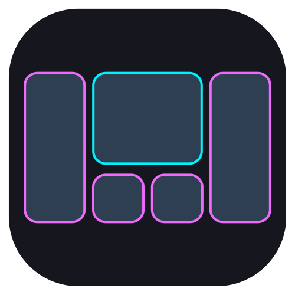

# Raven Tiling Emulator 🐦

<p align="center">
  
</p>


**Raven Tiling Emulator** es un gestor de ventanas dinámico en mosaico (Tiling Window Manager) de alto rendimiento diseñado específicamente para **KDE Plasma 6 (Wayland)**. 

Con el lanzamiento de la **Versión 4.5.5**, Raven consolida su salto arquitectónico definitivo: incorpora el **Efecto Nativo de KWin en C++ con aceleración OpenGL** para contornos de foco por hardware y animaciones elásticas, **blindaje anti-flicker** al capturar pantalla con Spectacle, **filtrado profundo de ventanas del sistema** (Bienvenida, Login/SDDM, Ajustes, Bloqueo), **suite de gestión TUI reestructurada con instalación atómica** libre de crash, cliente nativo para **CAVA** en el visualizador espectral, y atajos globales desacoplados hacia **Rust y `kglobalaccel`**.

---

## ⚡ Novedades Principales de la Versión 4.5.5

### 🎬 Contornos de Ventana por Hardware y Animaciones Nativas (`adapters/kwin_effect`)
- **Renderizado OpenGL Nativo en KWin**: Integración del plugin C++ `kwin4_effect_raven` que intercepta `paintWindow` en el compositor para dibujar contornos activos e inactivos de alta definición con shaders uniformes de OpenGL, sin impacto en la CPU ni sobrecarga en el script JS.
- **Transiciones Elásticas en Apertura y Reordenamiento**: Animaciones reactivas de nacimiento ("gelatina" / *Zoom-In* con curva `EaseOutBack`) y reordenamiento espacial por lotes (`AnimateBatch`), ejecutadas a los FPS nativos de la pantalla.
- **Blindaje Anti-Flicker ante Capturas de Pantalla (Spectacle Guard)**: Se solucionó el parpadeo en las ventanas subyacentes cuando se activan selectores rectangulares o herramientas de captura (Spectacle, Flameshot, Ksnip), evitando cambios espurios de foco.
- **Filtrado Profundo de Ventanas del Sistema**: Exclusión integral y homogénea en C++, JS y Rust de componentes como el Centro de Bienvenida (*Welcome Center* / `plasma-welcome`), pantallas de bloqueo e inicio de sesión (`sddm`, `plasmalogin`, `kscreenlocker`), y Preferencias del Sistema (`systemsettings`, `kcm_`).

### 🛠️ Suite TUI Modular e Instalación Atómica (`raven-setup.sh`)
- **Delegación Estricta de Opciones**: Menú de mantenimiento reorganizado donde cada opción cumple un propósito atómico y aislado:
  - `[1]` Instalación Completa (todos los componentes).
  - `[2]` Sincronización de Atajos Globales en Plasma.
  - `[3]` Recompilación Exclusiva del Motor y GUI Rust (con reinicio de servicio).
  - `[4]` Ensamblado del Bundle KWin Script (`main.js` y `reconfigure`).
  - `[5]` Compilación y Despliegue Dinámico del Efecto C++ KWin (recarga en caliente vía D-Bus sin reiniciar el compositor).
  - `[6]` Compilación y Despliegue del Plasmoide / Raven Hub.
  - `[7]` Auditoría y Estado en Vivo del Ecosistema.
  - `[8]` Desinstalación Limpia con purga total de caches de compilación (`cargo clean`, `adapters/*/build`).
- **Instalación Segura Anti-Crash**: Despliegue mediante `install -m 755` para generar nuevos inodos atómicamente, garantizando cero caídas del compositor Plasma 6 causadas por colisiones de memoria en archivos `.so` mapeados (`mmap`).

### 🎹 Integración Nativa con CAVA en el Lanzador (Raven Hub)
- **Visualizador Espectral Reactivo en Vivo**: Subproceso optimizado en C++ (`mediacontroller.cpp`) para interactuar con **CAVA** (*Console-based Audio Visualizer for ALSA/Pulse/PipeWire*).
- **Procesamiento Eficiente por Ráfagas (Frame Batching)**: Eliminación de micro-stuttering en el panel de Plasma al drenar tramas intermedias obsoletas y sincronizar `spectrumChanged` con la tasa de refresco del compositor.
- **Gestión Inteligente de Energía**: Generación automática de `/tmp/cava_raven_config` y suspensión del analizador en pausa o minimización del widget.

### ⌨️ Atajos Globales en Rust Nativo (`raven_backend_kwin`)
- **Desacoplamiento Completo de JavaScript**: El registro de combinaciones globales (`Meta+Space`, `Meta+J/K`, `Meta+F`, `Meta+X`, `Meta+Q`, `Meta+Shift+L`, etc.) se trasladó desde el script de KWin directamente al backend en Rust (`shortcuts.rs`).
- **Integración con `org.kde.kglobalaccel`**: Los atajos de Raven ahora se gestionan en el subsistema nativo de KDE Plasma, permitiendo verlos y editarlos en *Preferencias del Sistema ➡️ Accesos rápidos*.
- **Latencia Cero y "Dumb Bridge"**: El script de KWin ya no procesa atajos ni genera callbacks en `QJSEngine`, actuando como un ejecutor liviano.

### 📦 Stack Asíncrono de Vanguardia
- **Tokio 1.43 & zbus 5.19**: Migración y optimización hacia las últimas versiones del ecosistema asíncrono y D-Bus en Rust, aprovechando mejoras de throughput en canales `mpsc` y llamadas IPC no bloqueantes.
- **Cuarentena Dinámica y Rectificación en Rust**: Estabilización CSD calibrada para navegadores basados en Gecko/Chromium con modelo de sospecha activa y rectificación forzada post-layout.

---

## ⚡ Novedades de Versiones Anteriores (v4.5 / v4.2 / v4.1)

### 🖥️ Visualizador de Pantallas Wayland y Gestión Multialgoritmo
- **Canvas Vectorial Interactivo de Pantallas (`MonitorCanvas`)**: Nuevo componente gráfico en `raven_gui` que detecta y dibuja la geometría espacial real, resolución y escala física de los monitores conectados según los ve Wayland/KWin (estilo *KDE Display Configuration*).
- **Asignación Independiente de Algoritmos por Monitor**: Posibilidad de seleccionar un monitor individualmente y asignarle su propio esquema de mosaico (ej. *Raven Base* en la pantalla principal y *Monocle* o *Clásico* en secundarias).
- **Matriz de Escritorios Virtuales**: Configuración granular de algoritmos para combinaciones `Output||Desktop`.
- **Estrategia Flotante Desacoplada (`FloatingStrategy`)**: Algoritmo nativo de coste $O(1)$ (`"floating"` o `"none"`) que desactiva el mosaico en monitores o escritorios específicos, permitiendo que KWin gestione libremente las ventanas en ese espacio sin emitir comandos destructivos ni afectar al resto de pantallas activas.

---

## ⚡ Novedades de la Versión 4.2

### 🦀 Jerarquización del Crate `raven_backend_kwin` y Robustecimiento
- **Reemplazo Arquitectónico**: Consolidación y jerarquización del crate `raven_backend_kwin`, asumiendo ahora responsabilidades críticas que antes delegaba al script de JavaScript. Esto robustece enormemente la infraestructura de Rust al centralizar la fuente de verdad.
- **Cuarentena Dinámica en Rust**: La lógica heurística de cuarentena, el filtro de eventos en bucle (flapping loop) y los retardos estabilizadores para navegadores basados en Gecko se han trasladado por completo al backend de Rust.
- **Auditoría Estricta de Geometría**: Se implementó un nuevo estado `CommandAppliedState` vía D-Bus, lo que permite al motor de Rust comparar la geometría real reportada contra la geometría matemática esperada, forzando rectificaciones proactivas si la divergencia es superior a 2 píxeles.

### 🧹 Reducción del Puente KWin y Efectos Nativos
- **Adelgazamiento Extremo del Puente (JS)**: Refactorización profunda que limpia el código heredado y consolida el despacho de comandos. El bundle monolítico `main.js` redujo su tamaño en más de un 35% (de 1505 a apenas 967 líneas), convirtiéndose en un pasaje de comunicación ultraligero.
- **Efectos de Movimiento y Cero Crashes**: Se estabilizó de raíz la conectividad con la señal `windowAdded` nativa en el efecto C++. Esto elimina por completo las rupturas de sesión (crashes de Plasma) que ocurrían al recompilar o recargar el efecto, y asegura un rastreo fluido desde la apertura inicial de cada ventana.

---

## ⚡ Novedades de la Versión 4.1

### 🎇 Efectos Visuales Nativos (C++) y Sincronización Híbrida
- **Animaciones Nativas de Alto Rendimiento (`kwin_effect`)**: Se implementó un plugin nativo en C++ para KWin (`org.kde.kwin.RavenEffect`) que se comunica directamente con el motor Rust vía D-Bus. Esto desplaza la carga de animación del hilo de JavaScript al compositor nativo, permitiendo efectos fluidos a altos FPS.
- **Transición "Gelatina" Optimizada**: Nueva animación de apertura utilizando curvas elásticas (`OutElastic`) de 250ms con escalado dinámico. Proporciona un feedback visual súper rápido, profesional y táctil sin ser "perezoso" ni interrumpir el flujo de trabajo.
- **Tolerancia Geométrica Anti-Flicker (Flapping Loop)**: Incorporación de una tolerancia matemática de 3 píxeles en el motor de Rust que filtra el ruido del escalado fraccionario de Wayland y los cambios continuos de título en navegadores web (como Zen Browser), erradicando por completo el "brincoteo" o re-renderizado en bucle continuo.

### 🛡️ Cuarentena y Rectificación Activa
- **Doble Fase de Suspicacia Activa**: El motor ya no confía ciegamente en el estado geométrico inicial reportado por aplicaciones complejas. Se implementó un sistema de rectificación forzada (fase 2) mediado por temporizadores de `tokio` que elude las barreras anti-redundancia de KWin para corregir la ventana incondicionalmente.
- **Sincronización Concurrente de Layout**: Eliminación de retardos artificiales IPC. El diseño espacial y la orden D-Bus de animación se despachan concurrentemente, permitiendo a KWin procesar la geometría y la animación en un único frame de Wayland, evitando saltos visuales en aplicaciones ultra-rápidas (como terminales).

### 📜 Máquina Lua Experimental (Full Stack)
- **Scripting Dinámico y Configuración**: Se integró una máquina virtual de **Lua** operativa a nivel de backend y frontend (fase experimental). Esto abrirá las puertas a la creación de atajos dinámicos, scripting de reglas de ventanas avanzadas y el desarrollo de arquitecturas de mosaico personalizadas sin necesidad de compilar el núcleo en Rust.

---

### 🌉 Arquitectura "Thin Bridge" y Backend Wayland Nativo
- **Integración Nativa a Wayland (`raven_backend_wayland`)**: El motor de Rust ahora se conecta directamente al socket `$WAYLAND_DISPLAY` para consumir el protocolo `wl_output`. Las resoluciones, coordenadas físicas y escalas de los monitores se leen en tiempo real con latencia sub-milisegundo, sin depender de D-Bus ni de scripts lentos.
- **Adelgazamiento del Puente KWin ("Thin Bridge")**: El script de KWin fue despojado de sus pesados cálculos combinatorios de geometría espacial. KWin ahora opera exclusivamente en su rol irremplazable: un sensor de ventanas (para detectar foco) y un actuador ultraligero (para aplicar comandos geométricos).
- **Fusión Sensorial en Rust**: El motor `raven_engine` unifica transparentemente la topología autoritativa y ultrarrápida proveniente de Wayland con el estado de las ventanas proveniente de KWin, eliminando la redundancia y estabilizando el layout ante desconexiones de monitores.

---


---

## 📐 Algoritmos de Distribución Espacial (Layouts)

El motor geométrico se organiza en submódulos especializados dentro de `domain/layout/`, ofreciendo desacoplamiento total y 7 algoritmos seleccionables:

| Algoritmo | Identificador | Descripción y Caso de Uso |
| :--- | :--- | :--- |
| **Raven (BSP Foveal)** | `"raven"` | Composición dinámica foveal con ranuras de utilidad laterales e inferiores para monitores ultrapanorámicos. |
| **Clásico (Tall)** | `"tall"` | Columna maestra principal en el lateral con apilamiento secundario vertical. |
| **Monóculo** | `"monocle"` | Maximización total enfocada de una sola ventana para concentración intensiva. |
| **Flujo Avanzado** | `"strict_dwindle"` | División fractal en espiral binaria simétrica secuencial. |
| **Flujo Avanzado (Invertido)** | `"inverted_strict_dwindle"` | División fractal en espiral binaria simétrica secuencial con orden de acomodo invertido. |
| **Divisor** | `"divisor"` | Reparto equitativo proporcional en $N$ columnas verticales. |
| **Flotante (Libre)** | `"floating"` / `"none"` | Suspensión local de mosaico en $O(1)$ permitiendo ventanas flotantes sin interferencia en ese monitor. |

---

## 🚀 Arquitectura Hexagonal y Preparación Wayland Nativa

Raven Tiling ha completado gran parte de su transición arquitectónica mayor hacia una **arquitectura hexagonal (puertos y adaptadores)** orientada a compositores múltiples, sentando las bases del salto generacional definitivo a los protocolos Wayland.

```text
┌───────────────────────────────────────────────────────────────────┐
│                     Raven Engine (Core Domain)                    │
│   • TilingEngine (Raven BSP, Tall, Monocle, Dwindle, Divisor)     │
│   • Actor Model Tokio (RavenControllerActor - Concurrencia P3)     │
│   • raven_core (Topology, OutputNode, WindowNode, RavenAction)     │
└───────────────────────────────┬───────────────────────────────────┘
                                │ Trait CompositorBackend
                                │ (start_listener, apply_actions)
         ┌──────────────────────┴──────────────────────┐
         ▼                                             ▼
┌───────────────────────────────┐             ┌─────────────────────────────┐
│    raven_backend_kwin         │             │    raven_backend_wayland    │
│  (Adaptador KDE Plasma 6)     │             │  (v5.0.0 - Protocolos WLR)  │
│  • KWin Script (Sensor)       │             │  • zwlr_foreign_toplevel_v1 │
│  • kwin_effect C++ (Animador) │             │  • ext-workspace-v1         │
│  • zbus D-Bus sesión (Bridge) │             │  • Ingestión sub-milisegundo│
└───────────────────────────────┘             └─────────────────────────────┘
```

### 🧩 Desacoplamiento de Componentes (`raven_core` & `raven_backend_kwin`)
- **`raven_core` (Núcleo Puro Universal)**: 
  - Define tipos de datos agnósticos de pantalla y compositor: `Topology`, `OutputNode` (`name`, `rect`, `scale`), `WindowNode` y `Rect`.
  - Define las intenciones atómicas del motor mediante [`RavenAction`](crates/raven_core/src/action.rs) (`MoveWindow`, `SetFloating`, `FocusWindow`, etc.), sin prefijos ni dependencias de ningún entorno de escritorio específico.
  - Define el contrato de abstracción [`CompositorBackend`](crates/raven_core/src/backend.rs) y el canal unificado de eventos [`CompositorEvent`](crates/raven_core/src/backend.rs#L48).
- **`raven_backend_kwin` (Adaptador de Compositor KWin / Plasma 6)**:
  - Implementa el trait universal `CompositorBackend`.
  - Aísla por completo la serialización de D-Bus (`zbus 4`), el registro del servicio `org.kde.raven.Daemon` y la traducción bidireccional entre `KWinBridgeMessage` y `RavenAction`.
  - Emite señales asíncronas reactivas `tilingCommandsPending` para notificar a KWin sobre reacomodos sin generar contención.

---

## 🔮 Hoja de Ruta hacia la Versión 5.0 (Wayland Native Protocols)

Para la futura versión **v5.0.0**, Raven expandirá la integración inicial de Wayland para llevar la ingestión total y control de ventanas al **nivel nativo del protocolo Wayland**, superando definitivamente la dependencia de scripts intermediarios:

1. **Ingestión de Ventanas mediante Protocolos Wayland**:
   - Soporte nativo de `zwlr_foreign_toplevel_manager_v1` y `ext-foreign-toplevel-list-v1`: Descubrimiento, foco, minimización y cierre de superficies gestionado directamente desde Rust en espacio de usuario.
   - Soporte del protocolo `ext-workspace-v1` para la administración de escritorios virtuales independientes.
   - **Latencia Sub-milisegundo**: Tiempos de reacción de sincronización inferiores a 1 ms al interactuar directamente con el socket del servidor Wayland.
2. **Soporte de Compositores Múltiples**:
   - Gracias al trait `CompositorBackend`, la misma lógica matemática del motor de Raven podrá operar no solo en **KDE Plasma 6**, sino expandirse hacia compositores Wayland como **Hyprland**, **Sway** y entornos basados en **wlroots**.
3. **Generador Dinámico de Layouts (Lua Scripting Sandbox)**:
   - Aprovechando la máquina virtual **Lua** (introducida de forma experimental en v4.1), se permitirá diseñar, inyectar y cargar en caliente (*hot-reloading*) nuevas matemáticas de mosaico personalizadas desde el Centro de Control o mediante scripts de usuario sin reiniciar el demonio.

---

## 🎨 Centro de Control Nativo (`raven_gui`)
- **Interfaz Modular en egui/eframe**: Aplicación gráfica ligera, dividida en pestañas especializadas para una configuración integral:
  - **Composición**: Configuración de algoritmos globales de mosaico, scripts Lua personalizados, márgenes (gaps) y proporciones (`ratio`, `nmaster`).
  - **Pantallas**: Visualizador vectorial interactivo de monitores Wayland a escala física real y matriz de asignación de algoritmos por monitor o escritorio virtual.
  - **Reglas para Apps**: Exclusiones de mosaico, forzado de modo flotante, anclaje permanente a Picture-in-Picture (PiP) y gestión de clases en lista de cuarentena.
  - **Manual de Atajos**: Referencia visual e interactiva de todos los atajos de teclado globales integrados en KDE Plasma.
  - **Estado del Servicio**: Control directo del demonio nativo systemd (encendido, apagado, reinicio, autoinicio) y visualizador de logs en tiempo real.
  - **Acerca de**: Créditos, licencia GPL-3.0 e información del proyecto.
- **Previsualizador Avanzado en Vivo**: Renderiza espacialmente la distribución del layout seleccionado en tiempo real, ilustrando la estructura fractal hasta la 7ma ventana.
- **Posicionamiento PiP de 8 Puntos**: Configura las ventanas Picture-in-Picture a través de un lienzo interactivo con anclaje expandido: esquinas y puntos cardinales.
- **Sincronización de Paleta KDE y Efecto Glass**: Lee dinámicamente `~/.config/kdeglobals` adaptando la estética a cualquier tema del sistema (Dark/Light) con translucidez adaptativa.

### 🦊 Erradicación del Desacomodo Nativo en Navegadores Gecko
- **Protocolo de Doble Confirmación**: Elimina definitivamente los parpadeos, traslapes y saltos geométricos causados por la inicialización asíncrona de marcos CSD/SSD en navegadores basados en Gecko (Firefox, Zen, Floorp, LibreWolf).
- **Cuarentena Dinámica Heurística**: Mantiene la ventana entrante en una fase de aislamiento temporal calibrada dinámicamente según la clase de la aplicación, esperando a que el motor gráfico de la ventana notifique sus dimensiones estables definitivas.
- **Marca de Acomodo (`sb`)**: Aplica una bandera interna de verificación síncrona en el adaptador de KWin, garantizando que el motor de Rust solo integre la ventana a la retícula espacial una vez validado su estado geométrico final mediante confirmación bilateral.

---

## 📉 Eficiencia Energética, Huella en Disco y Rendimiento

El proyecto prioriza la eficiencia extrema y el uso mínimo de recursos del sistema.

### 📊 Evolución del Consumo por Versión

| Versión | Arquitectura | RAM (Runtime) | Peso Binario Motor | Tráfico IPC |
| :--- | :--- | :--- | :--- | :--- |
| **v1.0** | Python Puro | 55.0 MB | ~15 MB | Alto (Polling continuo) |
| **v1.6** | Híbrida (Python + Rust FFI) | ~25.9 MB | ~18 MB | Medio |
| **v2.6** | Rust Nativo Asíncrono | ~4.3 MB | 1.4 MB | Continuo |
| **v3.0** | Rust Nativo (Single-Trip IPC & 5 Layouts) | ~4.9 MB | 1.9 MB | Ultra-bajo (-90%) |
| **v3.3** | Rust Nativo + C++/QML Hub (6 Layouts & D-Bus Push) | ~5.4 MB | 1.9 MB | Tiempo Real Reactivo |
| **v4.1** | Rust Nativo + Efecto C++ Nativo (Zero-Delay IPC) | ~6.0 MB | 2.0 MB | Cero Latencia Visual |
| **v4.5** | **Rust Nativo + Wayland Directo & Sandbox Lua (Hexagonal)** | **~2.7 - 5.7 MB** | **2.0 MB** | **Sub-milisegundo (< 20ms)** |

### 💾 Desglose de Almacenamiento e Instalación Local

| Componente | Tipo de Recurso | Tamaño en Disco | Notas Técnicas |
| :--- | :--- | :--- | :--- |
| **`raven_engine`** | Daemon Nativo en Rust | **1.9 MB** | Motor de 6 layouts, topología PiP, D-Bus IPC (zbus 4). |
| **`raven_gui`** | Centro de Control (egui/eframe) | **4.3 MB** | Renderizado GPU nativo OpenGL, previsualizador fractal y lector de paletas KDE. |
| **Adaptadores & Plasmoides** | KWin Script, Plugin QML y Efecto C++ | **< 300 KB** | Puente sensor-actuador, panel hub y animaciones nativas. |
| **Total Instalación** | Entorno Local (`~/.local/share/raven/`) | **~6.9 MB** | **Huella ultra-compacta en almacenamiento.** |

---

## 🏗️ Estructura del Proyecto

El proyecto está organizado en un **Cargo Workspace** que integra el motor en Rust, el centro de control en egui, el plugin C++/QML y el script KWin:

```text
.
├── adapters/
│   ├── kwin_effect/                          # Efecto de Animación Nativo en C++
│   │   ├── src/
│   │   │   ├── dbus/                         # Adaptador de sesión D-Bus
│   │   │   ├── raveneffect.{h,cpp}           # Motor de curvas de aceleración y KWin::AnimationEffect
│   │   │   └── raveneffect_factory.{h,cpp}   # Plugin Factory para KWin
│   │   └── CMakeLists.txt
│   ├── kwin_script/                          # Script de KWin para Plasma 6
│   │   ├── contents/code/
│   │   │   ├── core/                         # Reglas de ventanas, cuarentena CSD y foco
│   │   │   ├── services/                     # D-Bus IPC Bridge y registro de Atajos Globales
│   │   │   ├── utils/                        # Logger, geometría, temporizadores
│   │   │   ├── index.js                      # Inicializador de hooks del ciclo de vida de KWin
│   │   │   └── main.js                       # Bundle monolítico generado para KWin
│   │   └── metadata.json                     # Descriptor del paquete de script KWin
│   └── plasmoid/                             # Plasmoide y Launcher para el Panel
│       ├── package/                          # Interfaz QML del Plasmoide (Raven Hub)
│       │   ├── contents/ui/                  # Vistas: MainWindowView, AppGridView, MediaWidgetView, etc.
│       │   └── metadata.json                 # Metadatos del Applet para Plasma 6
│       ├── plugin/                           # Plugin nativo C++ / QML de alto rendimiento
│       │   ├── apprunner.{h,cpp}             # Indexador y ejecutor de apps del sistema
│       │   ├── colorextractor.{h,cpp}        # Extractor de colores de carátulas
│       │   ├── mediacontroller.{h,cpp}       # Controlador MPRIS2 y barra de progreso
│       │   ├── ravencontroller.{h,cpp}       # Puente D-Bus con el motor Rust
│       │   ├── systemcontroller.{h,cpp}      # Acciones de sesión y energía
│       │   ├── systemstats.{h,cpp}           # Métricas de hardware, distro icon y paleta KDE
│       │   ├── weathercontroller.{h,cpp}     # Consulta meteorológica en segundo plano
│       │   ├── RavenTheme.qml                # Singleton de tokens de diseño adaptativo
│       │   └── CMakeLists.txt                # Configuración de compilación C++ Qt6
│       └── CMakeLists.txt
├── core/
│   └── engine_rs/                            # Motor Principal en Rust (Daemon Systemd)
│       ├── src/
│       │   ├── application/                  # Controlador de orquestación y ciclo de vida
│       │   ├── domain/                       # Lógica de dominio, layout strategies y saturación
│       │   ├── infrastructure/               # Adaptador de servicio D-Bus (zbus 4)
│       │   ├── ports/                        # Interfaces y contratos del motor
│       │   ├── lib.rs
│       │   └── main.rs
│       ├── tests/                            # Tests de integración, multimonitor y estrés
│       └── Cargo.toml
├── crates/
│   ├── raven_core/                           # Biblioteca núcleo pura y contratos compartidos
│   │   ├── src/
│   │   │   ├── action.rs                     # Catálogo de acciones atómicas de dominio (RavenAction)
│   │   │   ├── backend.rs                    # Trait CompositorBackend y eventos universales (CompositorEvent)
│   │   │   ├── config.rs                     # Esquema y persistencia de configuración
│   │   │   ├── geometry.rs                   # Topología universal (Topology, OutputNode, Rect, WindowNode)
│   │   │   └── lib.rs
│   │   └── Cargo.toml
│   └── raven_backend_kwin/                   # Adaptador de compositor desacoplado para KWin / Plasma 6
│       ├── src/
│       │   ├── commands.rs                   # Conversión de acciones a comandos D-Bus de KWin (TilingCommand)
│       │   ├── parser.rs                     # Ingestión y parseo de payloads y geometrías de KWin
│       │   ├── service.rs                    # Servicio zbus D-Bus `org.kde.raven.Events`
│       │   └── lib.rs                        # Implementación del trait universal CompositorBackend
│       └── Cargo.toml
├── assets/                                   # Iconografía y recursos gráficos oficiales
│   ├── icon_app/                             # Icono principal de la aplicación (SVG)
│   │   └── org.kde.raven.tiling.svg
│   └── icon_layouts/                         # Iconos SVG nativos por algoritmo (Light / Dark)
│       ├── dwindle_bsp_dark.svg / dwindle_bsp_light.svg
│       ├── tall_dark.svg / tall_light.svg
│       ├── monocle_dark.svg / monocle_light.svg
│       ├── strict_dwindle_dark.svg / strict_dwindle_light.svg
│       ├── inverted_strict_dwindle_dark.svg / inverted_strict_dwindle_light.svg
│       └── divisor_dark.svg / divisor_light.svg
├── raven_gui/                                # Centro de Control Gráfico en egui / Rust
│   ├── src/
│   │   ├── components/                       # Componentes gráficos (layout_preview, etc.)
│   │   ├── tabs/                             # Pestañas: composition, layouts, service, shortcuts, about
│   │   ├── app.rs                            # Estructura principal y ciclo de dibujado egui
│   │   ├── kde_theme.rs                      # Lector de temas nativos KDE
│   │   ├── models.rs / services.rs           # Estado y comunicación D-Bus
│   │   └── main.rs
│   └── Cargo.toml
├── systemd/                                  # Definiciones de servicios de usuario
│   ├── org.kde.raven.Daemon.service          # Activación por D-Bus bajo demanda
│   └── raven.service                         # Servicio continuo systemd
├── build_kwin_bundle.sh                      # Ensamblador del bundle JavaScript de KWin
├── raven-setup.sh                            # Suite TUI de instalación y mantenimiento
├── Cargo.toml                                # Configuración raíz del Workspace de Rust
└── README.md
```

---

## 🛠️ Instalación y Uso

### Requisitos Previos
- **KDE Plasma 6** sobre **Wayland** (Ubuntu 24.10+, Ubuntu 26.04 LTS, Debian Trixie/Sid, Fedora 40+, Arch Linux).
- Compilador de Rust (Cargo) y herramientas base de compilación (`cmake`, `extra-cmake-modules`).

#### Dependencias según tu distribución:
- **Debian / Ubuntu (Plasma 6):**
  ```bash
  sudo apt update && sudo apt install build-essential cmake extra-cmake-modules cargo rustc pkg-config \
      kwin-dev libplasma-dev qt6-base-dev qt6-declarative-dev libkf6coreaddons-dev libkf6config-dev libkf6windowsystem-dev libkdecoration3-dev
  ```
- **Arch Linux:**
  ```bash
  sudo pacman -S --needed base-devel cmake extra-cmake-modules kwin qt6-base qt6-declarative rust
  ```
- **Fedora:**
  ```bash
  sudo dnf install cmake extra-cmake-modules kwin-devel qt6-qtbase-devel qt6-qtdeclarative-devel kf6-kcoreaddons-devel cargo rust
  ```

### Pasos de Instalación y Gestión (TUI Suite)
```bash
git clone https://github.com/Vidruck/raven_tiling_emulator.git
cd raven_tiling_emulator

# Menú TUI Interactivo / Instalación
./raven-setup.sh               # O bien: ./raven-setup.sh --install
```

El script orquestador `./raven-setup.sh` ofrece una interfaz gráfica de consola (TUI) para:
- 🚀 **Instalación Completa**: Detección de dependencias, compilación de Rust, compilación del plugin C++, empaquetado JS, registro de KWin/Plasmoid y activación de Systemd.
- 🔄 **Recompilación Rápida**: Reconstruir binarios de Rust y reiniciar el servicio de usuario.
- 🎨 **Reconstruir Bundle KWin & Plasmoid**: Invocar `build_kwin_bundle.sh` y actualizar componentes en Plasma 6.
- 📊 **Ver Estado del Sistema**: Comprobar la presencia y ejecución del demonio `raven_engine`, KWin Script y Plasmoide.
- 🗑️ **Desinstalación limpia**: Detención de servicios y purgado selectivo de datos.

> **Nota para distribuciones Linux**: El instalador detecta automáticamente el gestor de paquetes del sistema (Fedora, Arch Linux, openSUSE, Debian/Ubuntu) e instala las herramientas necesarias en caso de que falten.

---

### ⌨️ Atajos de Teclado Globales (KWin / Plasma 6)

| Categoría | Atajo | Acción / Función |
| :--- | :--- | :--- |
| **Mosaico & Flotación** | **`Meta + Space`** | Habilitar / Deshabilitar el motor de mosaico (On / Off) |
| | **`Meta + Shift + F`** | Alternar Ventana Flotante Dinámica / Quick Peek (On / Off) |
| | **`Meta + F`** | Alternar Maximizar ventana activa (On / Off) |
| | **`Meta + X`** | Minimizar ventana activa |
| | **`Meta + Q`** | Cerrar ventana activa |
| | **`Meta + Shift + L`** | Ciclar secuencialmente entre los 6 algoritmos de Layout |
| **Navegación & Foco** | **`Meta + J` / `Meta + K`** | Mover el foco a la ventana Siguiente / Anterior |
| | **`Meta + Flechas`** | Foco direccional nativo (Izquierda / Derecha / Arriba / Abajo) |
| | **`Meta + Shift + J` / `Meta + Shift + K`** | Intercambiar posición de la ventana activa (Swap Siguiente / Anterior) |
| **Geometría & Dimensiones** | **`Meta + Alt + Right` / `Meta + Alt + Left`** | Aumentar / Reducir ANCHO de ventana (2D Dynamic Resize) |
| | **`Meta + Alt + Down` / `Meta + Alt + Up`** | Aumentar / Reducir ALTO de ventana (2D Dynamic Resize) |
| | **`Meta + H` / `Meta + L`** | Expandir / Contraer la proporción del área Master |
| | **`Meta + ]` / `Meta + [`** | Incrementar / Decrementar cantidad de ventanas principales (`nmaster`) |
| | **`Meta + =` / `Meta + -`** | Incrementar / Decrementar espaciado entre ventanas (Gaps ±2px) |
| **Multimonitor & Escritorios** | **`Meta + Shift + M` / `Meta + Shift + N`** | Migrar ventana activa al Monitor Siguiente / Anterior |
| | **`Meta + Shift + Right` / `Meta + Shift + Left`** | Migrar ventana activa al Escritorio Virtual Siguiente / Anterior |

---

## 🛡️ Solución para Aplicaciones que Rompen la Composición

Algunas aplicaciones presentan problemas conocidos en sesiones Wayland, como la apertura de múltiples ventanas temporales antes de terminar de inicializarse por completo. Esto provoca que la ventana final no se acomode correctamente en el mosaico o adquiera dimensiones inesperadas. Si notas este comportamiento, puedes mitigar el problema agregando la aplicación a la "Lista de Cuarentena".

**Pasos para añadir una aplicación a la lista de cuarentena:**
1. Abre el editor de menús de Plasma, busca la aplicación problemática y copia el texto que aparece en el campo **Programa**.
2. Abre **Raven Control Center > Reglas y Cuarentena > Lista de Cuarentena** y haz clic en **Añadir a la Lista**.
3. Pega el nombre que copiaste, guarda los cambios y reinicia la aplicación problemática.
> **Nota:** El motor es capaz de corregir la geometría y reasignar el tamaño adecuado ante cualquier actualización del entorno (por ejemplo, abrir otra ventana, interactuar con un plasmoide o minimizar y restaurar la aplicación). La recomendación de reiniciarla es únicamente para confirmar que, con la nueva regla de cuarentena, el problema desaparece desde el primer momento.

---

## 🧹 Desinstalación

Para remover completamente Raven y sus componentes del sistema sin afectar ningún otro programa:
```bash
./raven-setup.sh --uninstall
# O bien seleccionando la opción [6] ejecutando ./raven-setup.sh
```

---

---

## 📄 Licencia y Autoría

Este proyecto es software libre y de código abierto desarrollado y mantenido por **Alejandro González Hernández (Vidruck)** bajo los términos de la **GNU General Public License Version 3 (GPL-3.0)**.

Puedes consultar los términos legales completos en el archivo [LICENSE.txt](LICENSE.txt).

---

## ⚠️ Descargo de Responsabilidad (Disclaimer)

**Este software se proporciona "tal cual" (AS IS), sin garantía de ningún tipo.** Raven interactúa directamente con protocolos de Wayland, el compositor KWin y el bus D-Bus de Plasma. El usuario asume la responsabilidad de su uso.

---

*Desarrollado por **Alejandro González Hernández (Vidruck)**.*  
*¡Huélum!*